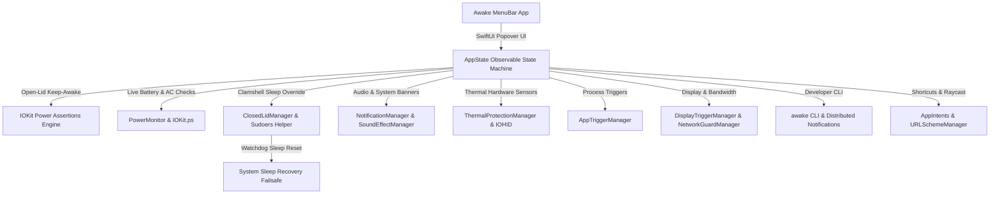

# Awake - Implementation Task List & Roadmap

> **Vision:** A 100% free, fully open-source, modern native macOS menu bar app inspired by WakeBee - keeping your Mac awake for AI agents, long builds, batch rendering, and downloads (even with the lid closed), with zero paywalls, zero subscriptions, and complete user privacy.

---

## Architecture Overview

---

## Implementation Progress

### Phase 1: Project Setup & Menu Bar Foundation
- [x] **1.1. Project & Target Configuration**
  - Configured Xcode project with `com.awake.mac`.
  - Set deployment target to macOS 14.0+ (Sonoma & Sequoia).
  - Configured `LSUIElement = YES` (pure menu bar application with no Dock clutter).
  - Configured `ENABLE_APP_SANDBOX = NO` for system-level sleep assertion overrides.
- [x] **1.2. Menu Bar Item Architecture**
  - Built custom `MenuBarController` managing `NSStatusItem`.
  - Dynamic status icon rendering (Customizable styles: Coffee, Eye, Owl, Flame, Bolt, Sun).
  - Dynamic menu bar countdown formatting (Standard, Compact, Progress Pie glyph).
  - Interactive SwiftUI popover presentation with transient event monitoring and outside-click dismiss.
  - Secondary right-click context menu (Quick +15m, Stop Session, Settings, Quit).
- [x] **1.3. App Lifecycle & Settings Skeleton**
  - Settings window scene using modern SwiftUI `SettingsView`.
  - Added "Launch at Login" support using macOS 14+ `SMAppService.mainApp`.

---

### Phase 2: Keep-Awake Core Engine (Open-Lid)
- [x] **2.1. IOKit Power Assertions Wrapper (`AssertionManager`)**
  - Directly wrapped `IOPMAssertionCreateWithName` and `IOPMAssertionRelease`.
  - Implemented dual assertions:
    - `kIOPMAssertionTypePreventUserIdleSystemSleep` (system awake, display may sleep).
    - `kIOPMAssertionTypePreventUserIdleDisplaySleep` (keeps display illuminated).
  - Ensured RAII-style assertion release on stop or deinit.
- [x] **2.2. Session State Machine (`AppState`)**
  - Session statuses: `.idle`, `.running(startedAt, endsAt)`.
  - 3 session modes:
    1. **Timer Mode:** Presets (15m, 30m, 1h, 2h, 4h, 8h) and smooth duration slider up to 24 hours.
    2. **Until Mode:** Native date/time picker to run until specific hour/minute.
    3. **Unlimited Mode:** Continuous execution until manual stop.
  - **"+15 Minutes"** quick-action button on running sessions.
- [x] **2.3. System Event Observers**
  - Automatic teardown and power assertion release in `applicationWillTerminate`.

---

### Phase 3: Battery, Power & Safeguards
- [x] **3.1. Battery & Power Source Monitoring (`PowerMonitor`)**
  - Integrated `IOKit.ps` (`IOPSCopyPowerSourcesInfo`, `IOPSCopyPowerSourcesList`, `IOPSGetPowerSourceDescription`).
  - Implemented dynamic event notifications using `IOPSNotificationCreateRunLoopSource` on `CFRunLoopGetMain()`.
  - Live power metrics displayed in Popover footer (battery icon, percentage, AC connected status).
- [x] **3.2. Power Enforcement Rules**
  - **Require Charger:** Automatically halts keep-awake if AC adapter is disconnected.
  - **Battery Cutoff Threshold:** Halts keep-awake if battery drops below user threshold (5% to 50%, default 20%).
  - Dismissable visual alert banners in the popover UI when safeguards are triggered.

---

### Phase 4: Closed-Lid (Clamshell) Sleep Prevention
- [x] **4.1. Helper Architecture & Protocol Definition (`ClosedLidManager`)**
  - One-time authorization setup installing `/etc/sudoers.d/awake_pmset`.
  - Non-intrusive passwordless `pmset -a disablesleep 1` during session and `0` when stopped.
- [x] **4.2. Watchdog & Failsafe Recovery**
  - Automatic sleep restoration on app termination (`AppDelegate.applicationWillTerminate`).
  - Restores default system sleep settings whenever a session ends or safeguard halts the app.
- [x] **4.3. Clamshell UI Flow & Safety Verification**
  - One-click setup flow in UI with administrative authorization modal.
  - Dedicated `ClosedLidCard` component in popover.
  - Visual status indicators (Installed vs Not Installed).
  - Thermal guidelines and safety warnings (flat surface ventilation).

---

### Phase 5: User Interface, Sound & Native Notifications
- [x] **5.1. Main Popover & Settings UI**
  - Quick presets (15m, 30m, 1h, 2h, 4h, 8h).
  - Interactive custom duration slider with minute/hour formatting.
  - Tabbed settings window (General, Appearance, Triggers, Presentation, Clamshell, CLI, Integrations, About).
- [x] **5.2. Sound & Haptic Feedback (`NotificationManager` & `SoundEffectManager`)**
  - Aesthetic sound packs with live preview audition buttons in Settings.
  - Session start, stop, timer finish, and safeguard alerts.
- [x] **5.3. Native macOS Notifications**
  - Integrated `UserNotifications` (`UNUserNotificationCenter`).
  - Notifications on session start, scheduled finish, and safeguard events.

---

### Phase 6: App-Based & Peripheral Triggers
- [x] **6.1. Running App Triggers (`AppTriggerManager`)**
  - Monitor running applications with automatic session activation and auto-stop on app termination.
- [x] **6.2. Display & Network Guard (`DisplayTriggerManager` & `NetworkGuardManager`)**
  - External display connection observer auto-activating keep-awake.
  - Zero-dependency BSD socket download speed monitor with configurable bandwidth threshold.

---

### Phase 7: Developer CLI, Shortcuts & Scriptability
- [x] **7.1. Embedded Native Developer CLI (`awake`)**
  - Command wrapper mode (`awake npm run build`, `awake docker up`).
  - Flag options (`awake -t 30m`, `awake -d`, `awake --on`, `awake --off`, `awake status`).
  - One-click installer in Settings -> CLI tab.
- [x] **7.2. App Intents, Siri & URL Scheme (`awake://`)**
  - Native AppIntents metadata generation and Siri voice commands.
  - Custom URL Scheme supporting start, stop, toggle, presentation, clamshell, and settings deep-links.
  - Ready-to-use Raycast script commands and Alfred launcher workflows.

---

### Phase 8: Customization & Appearance
- [x] **8.1. Custom Menu Bar Icon Styles (`AppearanceManager`)**
  - Selectable glyph styles: Coffee Cup, Awake Eye, Night Owl, Flame, Lightning Bolt, Sun.
- [x] **8.2. Acoustic Sound Packs (`SoundEffectManager`)**
  - Subtle Clicks, Modern Chimes, Crystal Glass, Soft Bells, and Muted/Silent.
- [x] **8.3. Status Bar Countdown Styles**
  - Standard `00:25:00`, Compact `25m` / `1.5h`, and Progress Pie Glyph `◔ 25m`.
- [x] **8.4. Appearance Tab in Settings**
  - Interactive icon picker cards, live preview pill capsule, and sound audition controls.
